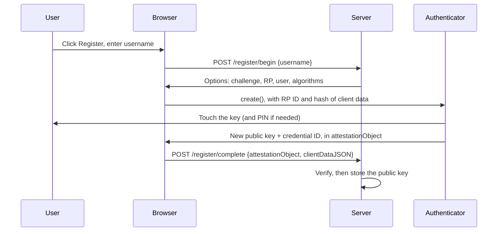
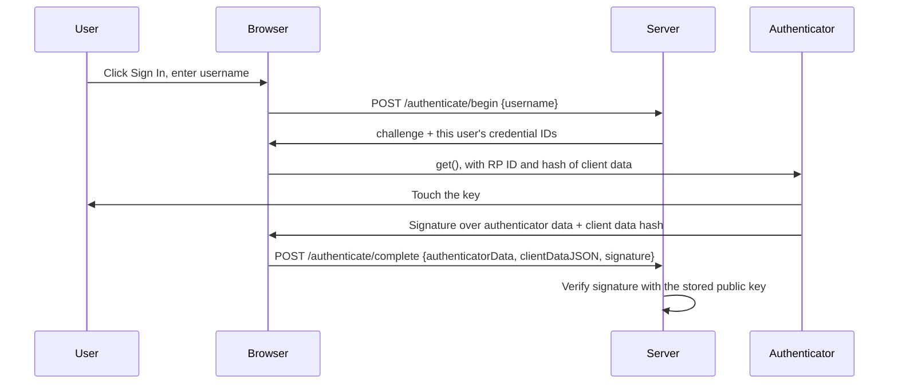

My [YubiKey posts]() look at FIDO2 from the key's side: resident keys, PINs, attestation. This post looks at the other end. What does a website actually do when you register a passkey or a security key, and what does it check when you sign in?

To find out, I wrote [ToyWebAuthN](https://github.com/Sunhick/ToyWebAuthN), a small WebAuthn server in Python. It uses Flask for the web app, Yubico's [python-fido2](https://github.com/Yubico/python-fido2) for the protocol, and MongoDB to store credentials. It's a learning project, not something to deploy, and writing this up showed me exactly where it falls short. Those gaps are in the last section, because they're the most useful part.

## The Idea in One Paragraph

With a password, you and the website share a secret, so anyone who steals the site's database or tricks you into typing it somewhere else has it too. With WebAuthn there's no shared secret. Your authenticator, such as a YubiKey or your phone, creates a new key pair for each website. The website stores only the **public key**. To sign in, the site sends a random challenge and the authenticator signs it with the **private key**, which never leaves the device. The signature also covers which website asked, so a phishing site can't reuse it.

Signing up and signing in are called **ceremonies** in the spec: registration and authentication. Each one is two round trips to the server, `begin` and `complete`.

## The Parts

| Part | In ToyWebAuthN | Job |
|---|---|---|
| **Relying party (RP)** | the Flask server | the website. Issues challenges and verifies responses |
| **Client** | the browser, via `navigator.credentials` | passes requests to the authenticator, and adds the page's origin |
| **Authenticator** | a YubiKey, or a phone or laptop | holds the private keys, checks you're present, and signs |
| **RP ID** | a domain name, like `example.com` | the scope of the credential. A key made for one RP ID can't be used for another |

The browser is a trusted middleman here. It's the part that knows which site you're really on, and it writes that origin into data the authenticator signs.

## Registration: Creating the Credential



### Step 1: The server builds the options

`/register/begin` creates a random user ID and asks python-fido2 for a challenge. The options tell the browser which site this is, who the user is, and which signature algorithms the server accepts:

```python
user = PublicKeyCredentialUserEntity(
    id=os.urandom(32),        # random, so it reveals nothing about the user
    name=username,
    display_name=username,
)
options, state = self.server.register_begin(
    user,
    user_verification=UserVerificationRequirement.PREFERRED,
)
```

`state` holds the challenge, and it stays on the server side. ToyWebAuthN keeps it in the Flask session and pops it off in the `complete` step, so each challenge can only be used once.

The algorithm list is two COSE identifiers: `-7` is ES256 (ECDSA on P-256 with SHA-256) and `-257` is RS256 (RSA with SHA-256). Most security keys use ES256.

### Step 2: The browser asks the authenticator

WebAuthn moves binary data around, but JSON can't carry bytes, so the challenge and user ID travel as base64url. The client decodes them before calling the browser API:

```typescript
options.publicKey.challenge = base64URLDecode(options.publicKey.public_key.challenge);
options.publicKey.user.id = base64URLDecode(options.publicKey.user.id);

const credential = await navigator.credentials.create(options);
```

The browser checks that the RP ID matches the site you're on, then builds the **client data**:

```json
{
  "type": "webauthn.create",
  "challenge": "<the server's challenge>",
  "origin": "https://example.com"
}
```

It hands the authenticator the RP ID and a SHA-256 hash of that JSON. The authenticator waits for a touch, creates a fresh key pair for this RP ID, and returns the new public key inside an **attestation object**.

### Step 3: What's inside the attestation object

The attestation object is CBOR, a binary form of JSON. Its most important part is the **authenticator data**, a packed byte string:

| Bytes | Field | Meaning |
|---|---|---|
| 32 | RP ID hash | SHA-256 of the RP ID the authenticator used |
| 1 | Flags | UP (user present, bit 0), UV (user verified, bit 2), AT (credential data included, bit 6), and others |
| 4 | Sign count | how many times this credential has signed. Some authenticators always report 0 |
| 16 | AAGUID | identifies the authenticator model |
| 2 + n | Credential ID | the handle the server will use to refer to this key |
| varies | Public key | in COSE format |

The attestation object can also carry an **attestation statement**: a signature from the manufacturer proving which kind of authenticator made the key. ToyWebAuthN asks for none (`AttestationConveyancePreference.NONE`). Most websites don't need to know the make and model of your key, and skipping it is more private.

### Step 4: The server verifies and stores

`/register/complete` hands everything to python-fido2, which checks that:
- the client data `type` is `webauthn.create`,
- the challenge matches the one saved in `state`,
- the origin is one the server allows,
- the RP ID hash matches SHA-256 of the server's own RP ID,
- the user-present flag is set.

If all of that passes, the server stores three things: the credential ID, the public key, and the sign count. ToyWebAuthN encodes the COSE public key as CBOR and saves it in MongoDB:

```python
auth_data = self.server.register_complete(state, data)
credential_id = auth_data.credential_data.credential_id
public_key = auth_data.credential_data.public_key   # a COSE key
```

There's no secret in that record. If someone stole the whole database, they'd have public keys, and a public key can't sign you in.

## Authentication: Proving You Hold the Key



### Step 1: The server picks the credentials

`/authenticate/begin` looks up the username's credentials and sends their IDs as `allowCredentials`, with a new challenge:

```python
credentials = list(self.db.credentials.find({'username': username}))
options, state = self.server.authenticate_begin(
    [{'type': 'public-key', 'id': websafe_decode(c['id'])} for c in credentials],
    user_verification=UserVerificationRequirement.PREFERRED,
)
```

Listing credential IDs is why you type a username first. With **discoverable credentials** (resident keys), the authenticator stores the account itself and can sign in without a username. That's what "passkeys" usually means. ToyWebAuthN registers non-discoverable credentials (`requireResidentKey: False`). My [advanced YubiKey post]() covers how resident keys use up the key's limited storage.

### Step 2: The authenticator signs

The browser builds client data again, this time with `"type": "webauthn.get"`. The authenticator signs this:

```text
signature = Sign(private_key, authenticatorData || SHA-256(clientDataJSON))
```

Because the origin is inside `clientDataJSON`, and the RP ID hash is inside `authenticatorData`, the signature is bound to the real website. If a phishing page at `examp1e.com` relayed your sign-in, its origin would be in the signed data and the real server would reject it. Usually it doesn't get that far: the authenticator won't even use a credential for an RP ID it wasn't created for.

### Step 3: The server verifies

`authenticate_complete` checks the same things as registration: type, challenge, origin and RP ID hash. Then it verifies the signature against the stored public key:

```python
self.server.authenticate_complete(state, [credential], data)
```

Then ToyWebAuthN checks the **sign count**. If the authenticator reports a count that isn't higher than the last one stored, that can mean the key was cloned. The server logs a warning and saves the new count.

## What a Real Server Must Do Differently

The README says not to use ToyWebAuthN in production, and going through the code for this post showed me why. The cryptography is fine, because python-fido2 handles it. The gaps are in the code around it: **which account a credential belongs to**. These are the mistakes a real server has to avoid.

### 1. Don't take the user's identity from the request

`/register/complete` saves the username and user ID that the **browser sends back** in the request body:

```python
'username': data['user']['name'],
'userId': data['user']['id'],
```

Anyone can edit that request. Someone could start registering as `eve`, then change the name to `bob` in the `complete` request, and their key would be saved to Bob's account. The fix is to keep the user in server-side state during `begin` and read it from there in `complete`, never from the request.

### 2. Adding a key to an existing account needs a signed-in user

`/register/begin` notices when a username already has credentials, logs a warning, and continues anyway. So anyone can add their own key to an existing account just by registering with that name. A real server only lets you register a new key for an account you're already signed in to. Otherwise it's a new account and a name that's already taken.

### 3. Check that the key belongs to the account signing in

At sign-in, the server looks up the credential by its ID alone, and takes the username from the `begin` request:

```python
credential_dict = self.db.credentials.find_one({'id': websafe_encode(credential_id)})
```

The browser only offers the credentials listed in `allowCredentials`, but an attacker can skip the browser. They could start a sign-in as `bob`, then answer with a signature from **their own** registered key, and the server would sign them in as Bob. The fix is to look up the credential by ID **and** username, pass only that user's credentials to `authenticate_complete`, and check the `userHandle` in the response against the stored user ID.

Together, gaps 1–3 add up to account takeover. They're the most important lesson here: WebAuthn proves someone holds a key. Your code has to decide whose account that key belongs to.

### 4. Ask for user verification consistently

Both ceremonies ask for user verification as `preferred`. But sign-in then rejects any response without the UV flag. So a security key without a PIN can register successfully and then never sign in. Pick one rule and use it in both places. Either set `UserVerificationRequirement.REQUIRED` everywhere, or don't require the flag at sign-in.

### 5. Handle sign counts properly

The server warns when the count doesn't go up, but accepts the sign-in anyway. It also warns every time for authenticators that always report 0, which includes many synced passkeys. The spec's rule: if both the stored and new counts are 0, skip the check. Otherwise, the new count must be higher, and what to do when it isn't is a policy decision. Blocking the sign-in or flagging the account are both reasonable.

### 6. Keep the dev server private

`main.py` starts Flask on all network interfaces (`host='0.0.0.0'`) with `debug=True`. That combination is risky even on a home network. Flask's debug mode serves an interactive debugger that can run code if anyone else on the network can reach it. For local testing, bind to `127.0.0.1` and turn debug off.

The RP ID is also set in several places that can disagree. `WebAuthnManager` hard-codes a LAN IP address, while registration and sign-in each look up the IP address separately. A real server sets its RP ID once, to its domain name, and uses that value everywhere.

## What I Took Away

- **python-fido2 does the hard part.** Parsing CBOR and COSE keys, checking challenges, origins and RP ID hashes, and verifying signatures are all one library call each. I wouldn't write those myself.
- **The website never sees a secret.** Its database holds only public keys, which is a real improvement over storing password hashes.
- **Phishing resistance comes from the browser.** The authenticator signs the origin the browser reports, so a fake site can't produce a signature the real one will accept.
- **The protocol proves possession, not ownership.** Every gap above is in deciding *which account* a valid signature belongs to. That part is entirely up to the server.

The code is on [GitHub](https://github.com/Sunhick/ToyWebAuthN). If you want to read further, the [WebAuthn spec](https://www.w3.org/TR/webauthn-2/) is the source of truth, and its "Verifying an Authentication Assertion" section lists every check a server must make.
